# Pertemuan-9-PWeb---Latihan-PHP
Dalam repositori ini, saya akan mendokumentasikan latihan php pertemuan 9 Pemrograman Web B 2026. Saya berlatih menggunakan php secara sederhana, tampilan web dapat dikembangkan untuk berikutnya.

### Identitas
Nama    : Benedictus Imanuel Wicaksono
NRP     : 5025251039

## Latihan: Membuat Aplikasi CRUD [Studi Kasus Pendaftaran Siswa Baru] dengan PHP dan MYSQL
Sumber latihan dari https://www.petanikode.com/tutorial-php-mysql/

### Set Up

1. Buat database baru `pendaftaran_siswa`<br>
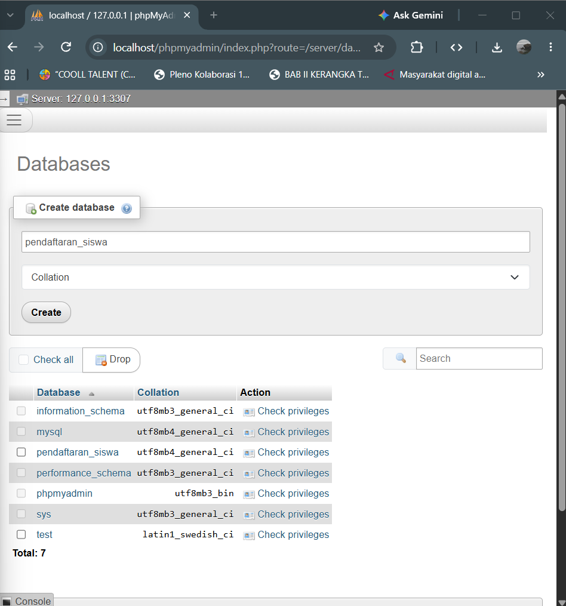<br>

2. Buat table `calon_siswa`<br>
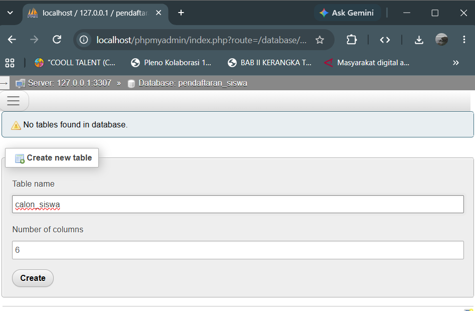<br>
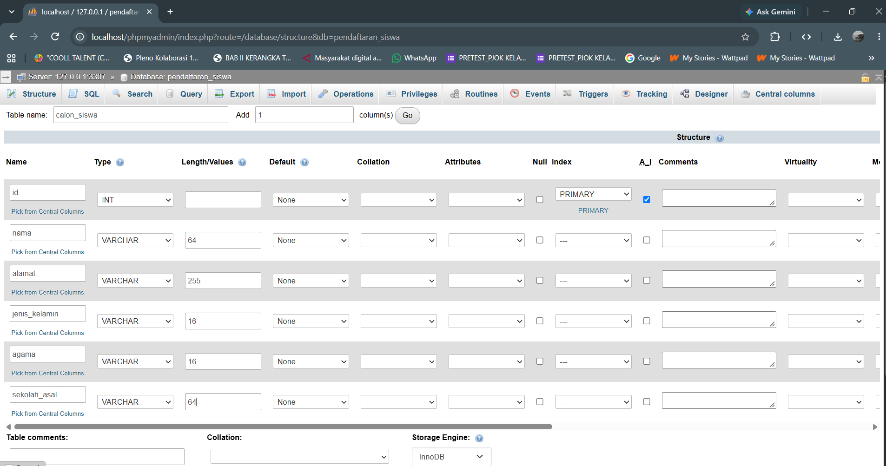<br>

3. Insert table `calon_siswa`<br>
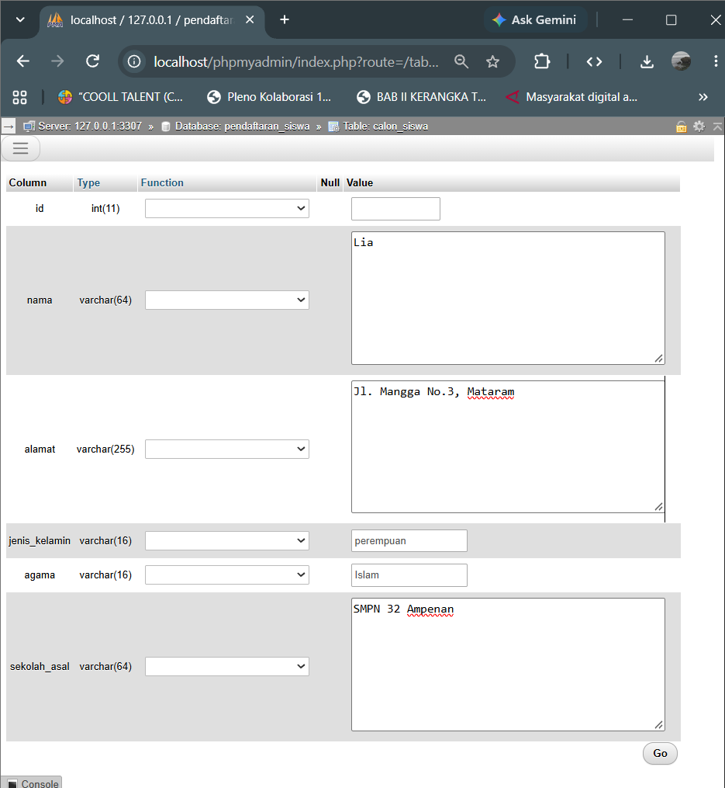<br>
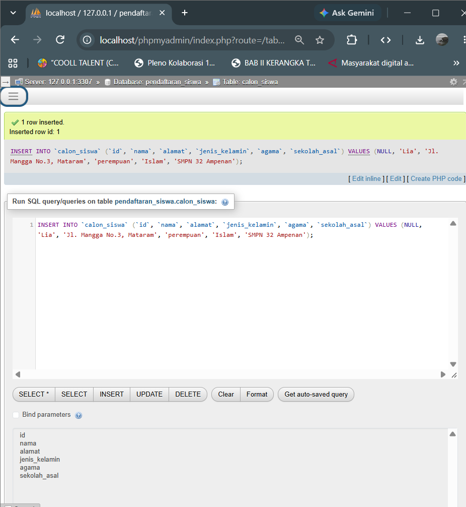<br>

4. Jalankan perintah beriikut sebagai direktori file-file php yang dibutuhkan di htdocs(Karena saya menggunakan windows) `mkdir C:\xampp\htdocs\pendaftaran-siswa`

5. Buat 8 file php yang diperlukan, ini command untuk powershell `New-Item -ItemType File config.php, index.php, list-siswa.php, form-daftar.php, proses-pendaftaran.php, form-edit.php, proses-edit.php, hapus.php`
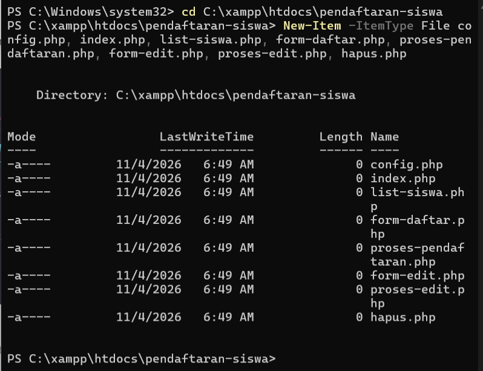

### File-file PHP

1. **Config.php** untuk menyimpan konfigurasi database, isi dengankode berikut:
```
<?php

$server = "127.0.0.1";
$user = "root";
$password = "";
$nama_database = "pendaftaran_siswa";
$port = 3307;

$db = mysqli_connect($server, $user, $password, $nama_database, $port);

if( !$db ){
    die("Gagal terhubung dengan database: " . mysqli_connect_error());
}

?>
```

2. **index.php** sebagai halaman utama, isi dengan kode ini
```
<!DOCTYPE html>
<html>
<head>
    <title>Pendaftaran Siswa Baru | SMK Coding</title>
</head>

<body>
    <header>
        <h3>Pendaftaran Siswa Baru</h3>
        <h1>SMK Coding</h1>
    </header>

    <h4>Menu</h4>
    <nav>
        <ul>
            <li><a href="form-daftar.php">Daftar Baru</a></li>
            <li><a href="list-siswa.php">Pendaftar</a></li>
        </ul>
    </nav>

    </body>
</html>
```

3. **list-siswa.php** halaman untuk menampilkan data siswa, isi dengan kode berikut
```
<?php include("config.php"); ?>

<!DOCTYPE html>
<html>
<head>
    <title>Pendaftaran Siswa Baru | SMK Coding</title>
</head>

<body>
    <header>
        <h3>Siswa yang sudah mendaftar</h3>
    </header>

    <nav>
        <a href="form-daftar.php">[+] Tambah Baru</a>
    </nav>

    <br>

    <table border="1">
    <thead>
        <tr>
            <th>No</th>
            <th>Nama</th>
            <th>Alamat</th>
            <th>Jenis Kelamin</th>
            <th>Agama</th>
            <th>Sekolah Asal</th>
            <th>Tindakan</th>
        </tr>
    </thead>
    <tbody>

        <?php
        $sql = "SELECT * FROM calon_siswa";
        $query = mysqli_query($db, $sql);

        while($siswa = mysqli_fetch_array($query)){
            echo "<tr>";

            echo "<td>".$siswa['id']."</td>";
            echo "<td>".$siswa['nama']."</td>";
            echo "<td>".$siswa['alamat']."</td>";
            echo "<td>".$siswa['jenis_kelamin']."</td>";
            echo "<td>".$siswa['agama']."</td>";
            echo "<td>".$siswa['sekolah_asal']."</td>";

            echo "<td>";
            echo "<a href='form-edit.php?id=".$siswa['id']."'>Edit</a> | ";
            echo "<a href='hapus.php?id=".$siswa['id']."'>Hapus</a>";
            echo "</td>";

            echo "</tr>";
        }
        ?>

    </tbody>
    </table>

    <p>Total: <?php echo mysqli_num_rows($query) ?></p>

    </body>
</html>
```

4. **form-daftar.php** halaman formulir pendaftaran, berikut isinya
```
<!DOCTYPE html>
<html>
<head>
    <title>Formulir Pendaftaran Siswa Baru | SMK Coding</title>
</head>

<body>
    <header>
        <h3>Formulir Pendaftaran Siswa Baru</h3>
    </header>

    <form action="proses-pendaftaran.php" method="POST">

        <fieldset>

        <p>
            <label for="nama">Nama: </label>
            <input type="text" name="nama" placeholder="nama lengkap" />
        </p>
        <p>
            <label for="alamat">Alamat: </label>
            <textarea name="alamat"></textarea>
        </p>
        <p>
            <label for="jenis_kelamin">Jenis Kelamin: </label>
            <label><input type="radio" name="jenis_kelamin" value="laki-laki"> Laki-laki</label>
            <label><input type="radio" name="jenis_kelamin" value="perempuan"> Perempuan</label>
        </p>
        <p>
            <label for="agama">Agama: </label>
            <select name="agama">
                <option>Islam</option>
                <option>Kristen</option>
                <option>Hindu</option>
                <option>Budha</option>
                <option>Atheis</option>
            </select>
        </p>
        <p>
            <label for="sekolah_asal">Sekolah Asal: </label>
            <input type="text" name="sekolah_asal" placeholder="nama sekolah" />
        </p>
        <p>
            <input type="submit" value="Daftar" name="daftar" />
        </p>

        </fieldset>

    </form>

    </body>
</html>
```

5. **proses-pendaftaran.php** skrip yang memproses pendaftaran, berikut isinya
```
<?php

include("config.php");

// cek apakah tombol daftar sudah diklik atau blum?
if(isset($_POST['daftar'])){

    // ambil data dari formulir
    $nama = $_POST['nama'];
    $alamat = $_POST['alamat'];
    $jk = $_POST['jenis_kelamin'];
    $agama = $_POST['agama'];
    $sekolah = $_POST['sekolah_asal'];

    // buat query
    $sql = "INSERT INTO calon_siswa (nama, alamat, jenis_kelamin, agama, sekolah_asal) VALUE ('$nama', '$alamat', '$jk', '$agama', '$sekolah')";
    $query = mysqli_query($db, $sql);

    // apakah query simpan berhasil?
    if( $query ) {
        // kalau berhasil alihkan ke halaman index.php dengan status=sukses
        header('Location: index.php?status=sukses');
    } else {
        // kalau gagal alihkan ke halaman indek.php dengan status=gagal
        header('Location: index.php?status=gagal');
    }


} else {
    die("Akses dilarang...");
}

?>
```

6. **form-edit.php** form untuk edit data siswa, berikut isinya
```
<?php

include("config.php");

// kalau tidak ada id di query string
if( !isset($_GET['id']) ){
    header('Location: list-siswa.php');
}

//ambil id dari query string
$id = $_GET['id'];

// buat query untuk ambil data dari database
$sql = "SELECT * FROM calon_siswa WHERE id=$id";
$query = mysqli_query($db, $sql);
$siswa = mysqli_fetch_assoc($query);

// jika data yang di-edit tidak ditemukan
if( mysqli_num_rows($query) < 1 ){
    die("data tidak ditemukan...");
}

?>


<!DOCTYPE html>
<html>
<head>
    <title>Formulir Edit Siswa | SMK Coding</title>
</head>

<body>
    <header>
        <h3>Formulir Edit Siswa</h3>
    </header>

    <form action="proses-edit.php" method="POST">

        <fieldset>

            <input type="hidden" name="id" value="<?php echo $siswa['id'] ?>" />

        <p>
            <label for="nama">Nama: </label>
            <input type="text" name="nama" placeholder="nama lengkap" value="<?php echo $siswa['nama'] ?>" />
        </p>
        <p>
            <label for="alamat">Alamat: </label>
            <textarea name="alamat"><?php echo $siswa['alamat'] ?></textarea>
        </p>
        <p>
            <label for="jenis_kelamin">Jenis Kelamin: </label>
            <?php $jk = $siswa['jenis_kelamin']; ?>
            <label><input type="radio" name="jenis_kelamin" value="laki-laki" <?php echo ($jk == 'laki-laki') ? "checked": "" ?>> Laki-laki</label>
            <label><input type="radio" name="jenis_kelamin" value="perempuan" <?php echo ($jk == 'perempuan') ? "checked": "" ?>> Perempuan</label>
        </p>
        <p>
            <label for="agama">Agama: </label>
            <?php $agama = $siswa['agama']; ?>
            <select name="agama">
                <option <?php echo ($agama == 'Islam') ? "selected": "" ?>>Islam</option>
                <option <?php echo ($agama == 'Kristen') ? "selected": "" ?>>Kristen</option>
                <option <?php echo ($agama == 'Hindu') ? "selected": "" ?>>Hindu</option>
                <option <?php echo ($agama == 'Budha') ? "selected": "" ?>>Budha</option>
                <option <?php echo ($agama == 'Atheis') ? "selected": "" ?>>Atheis</option>
            </select>
        </p>
        <p>
            <label for="sekolah_asal">Sekolah Asal: </label>
            <input type="text" name="sekolah_asal" placeholder="nama sekolah" value="<?php echo $siswa['sekolah_asal'] ?>" />
        </p>
        <p>
            <input type="submit" value="Simpan" name="simpan" />
        </p>

        </fieldset>


    </form>

    </body>
</html>
```

7. **proses-edit.php** skrip untuk memproses edit/update, ini isinya
```
<?php

include("config.php");

// cek apakah tombol simpan sudah diklik atau blum?
if(isset($_POST['simpan'])){

    // ambil data dari formulir
    $id = $_POST['id'];
    $nama = $_POST['nama'];
    $alamat = $_POST['alamat'];
    $jk = $_POST['jenis_kelamin'];
    $agama = $_POST['agama'];
    $sekolah = $_POST['sekolah_asal'];

    // buat query update
    $sql = "UPDATE calon_siswa SET nama='$nama', alamat='$alamat', jenis_kelamin='$jk', agama='$agama', sekolah_asal='$sekolah' WHERE id=$id";
    $query = mysqli_query($db, $sql);

    // apakah query update berhasil?
    if( $query ) {
        // kalau berhasil alihkan ke halaman list-siswa.php
        header('Location: list-siswa.php');
    } else {
        // kalau gagal tampilkan pesan
        die("Gagal menyimpan perubahan...");
    }


} else {
    die("Akses dilarang...");
}

?>
```

8. **hapus.php** skrip untuk menghapus data dari database, ini isinya
```
<?php

include("config.php");

if( isset($_GET['id']) ){

    // ambil id dari query string
    $id = $_GET['id'];

    // buat query hapus
    $sql = "DELETE FROM calon_siswa WHERE id=$id";
    $query = mysqli_query($db, $sql);

    // apakah query hapus berhasil?
    if( $query ){
        header('Location: list-siswa.php');
    } else {
        die("gagal menghapus...");
    }

} else {
    die("akses dilarang...");
}

?>
```

### Demo Setiap Page

1. Landing page
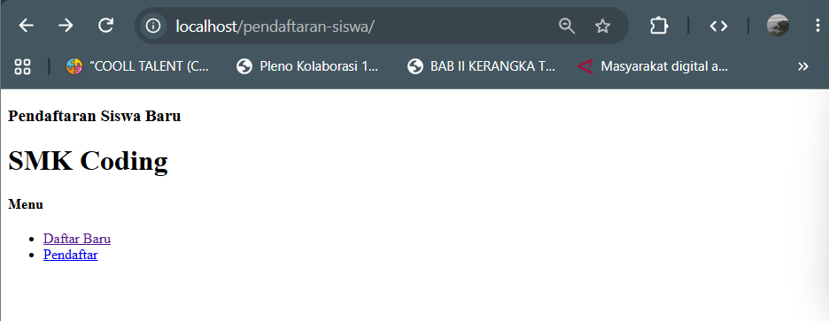

2. Form Pendaftaran
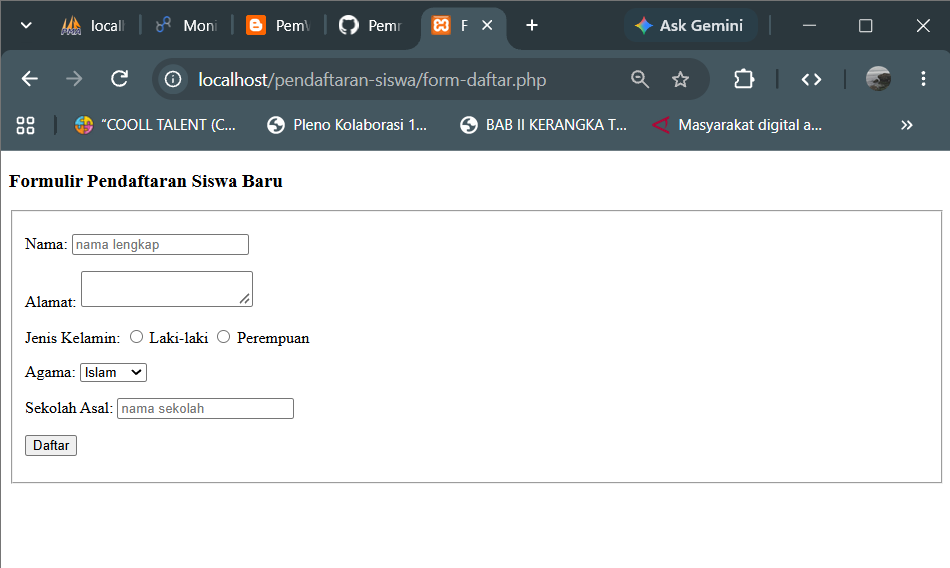

3. Hasil Pendaftaran(list)
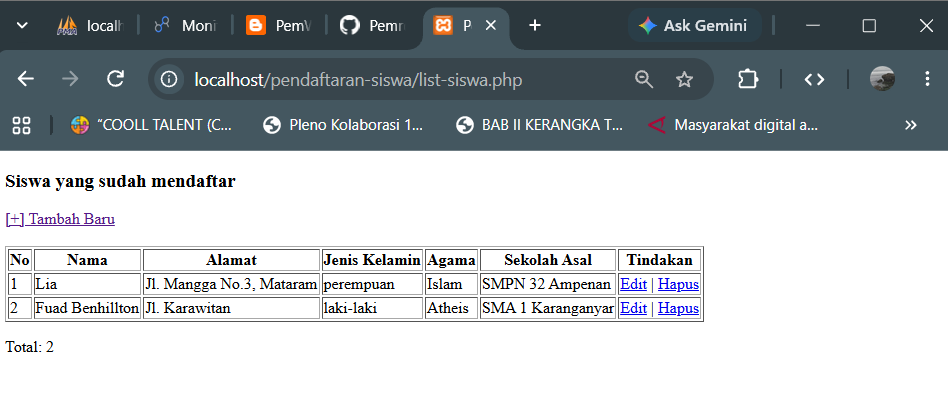

4. Edit Data
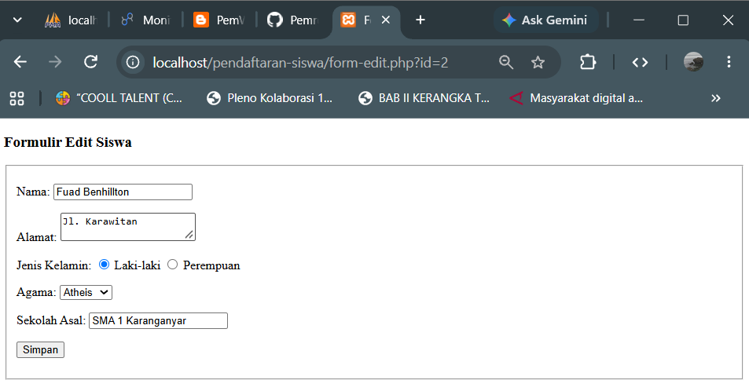

5. Hasil Edit
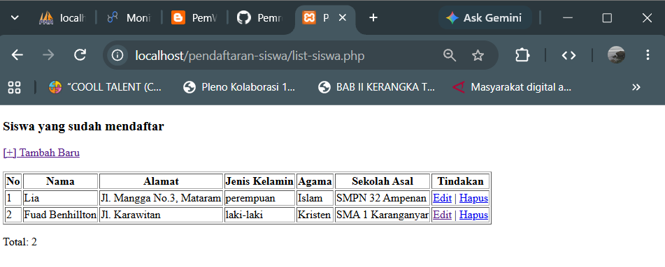

6. Hapus Data (saya hapus data yang sebelumnya ditambahkan)
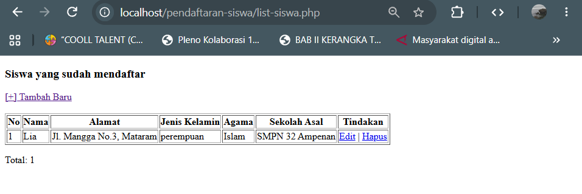

7. Jika langsung menuju hapus.php
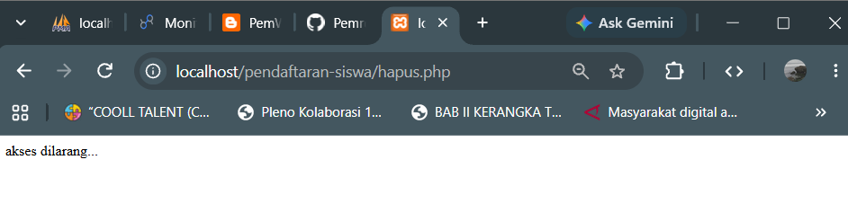

## Catatan Akhir
Untuk konfigurasi php harus disesuaikan dengan perangkat masing masing, saya menggunakan xampp di windows.